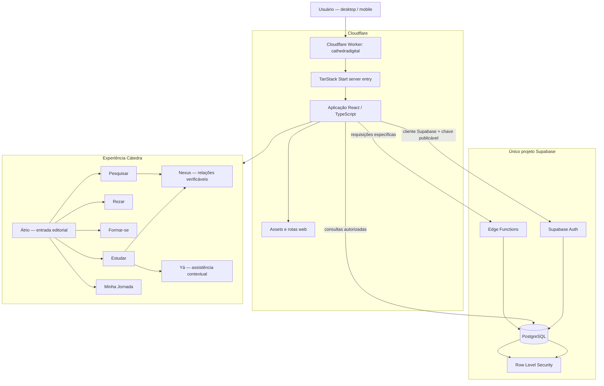
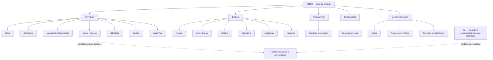
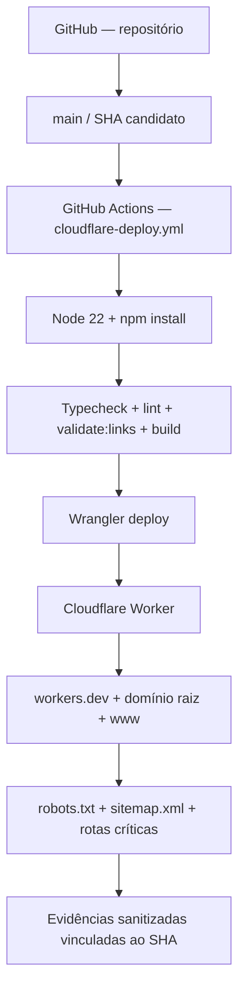
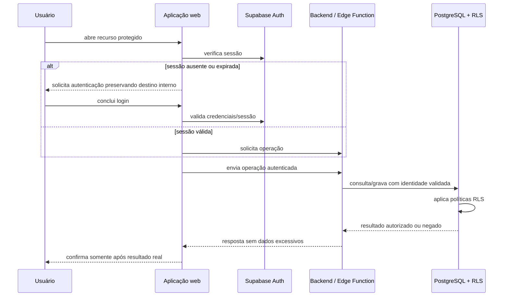

# Diagramas oficiais — Cátedra Digital

**Revisão:** 2026-10-29  
**Base:** leitura do README, `src/App.tsx`, `src/config/moduleNavigation.ts`, `src/integrations/supabase/client.ts`, `src/server.ts`, `vite.config.ts`, `wrangler.jsonc`, `supabase/config.toml`, `package.json` e workflow Cloudflare em `main`.

Os diagramas separam a arquitetura de produto desejada da configuração atualmente observada. Não são prova de execução ou disponibilidade dos serviços.

## 1. Arquitetura lógica e fronteiras



### Limites de segurança

- O navegador é ambiente não confiável.
- A chave publicável Supabase não equivale a uma chave privilegiada.
- Autenticação identifica a sessão; autorização deve ser aplicada no backend e no banco.
- RLS protege dados no PostgreSQL, mas precisa ser testada com cenários positivos e negativos.
- Yá não é autoridade doutrinal; Nexus não transforma relações sem fundamento em fontes oficiais.

## 2. Organização funcional do produto



### Divergência entre especificação e código

O Documento Mestre agrupa Nexus, Biblioteca e Santos junto ao ambiente Estudar. O registro de navegação atual em `src/config/moduleNavigation.ts` lista esses itens no grupo Pesquisar; Hoje aparece como item dentro de Minha Jornada. O diagrama acima representa a arquitetura funcional do produto documentada no Documento Mestre. A divergência de agrupamento deve ser resolvida em uma decisão de produto e em mudança própria de navegação, não por alteração incidental desta documentação.

Igreja Viva está no escopo de produto, mas não possui especificação modular própria no conjunto revisado.

## 3. Publicação e validação



**Estado do workflow observado em `main`:** o workflow dispara em push para `main` e manualmente. Executa typecheck, lint, validação de rotas e build antes do deploy. Não contém, por si só, auditoria completa de dependências nem Playwright autenticado desktop/mobile antes da publicação.

**Proposta em andamento:** a PR #213 propõe fluxo manual com gates adicionais, fixação do SHA, auditoria, Playwright e validação pré/pós-deploy. Enquanto não estiver integrada e validada, não apresentar essa proposta como fluxo ativo.

### Gate de liberação exigido

```text
CI aprovado
   +
Auditoria de dependências aprovada
   +
Playwright desktop e mobile aprovado
   +
Tudo no mesmo SHA
   +
Autorização explícita
   ↓
Publicação Cloudflare
   ↓
Validação da versão efetivamente servida
```

Se um gate estiver pendente, a liberação permanece bloqueada. Uma execução de build isolada, HTTP 200 ou workflow iniciado não substitui as evidências exigidas.

## 4. Fluxo de autenticação e dados pessoais



O diagrama representa o contrato de segurança esperado. Cada fluxo real precisa de teste; o diagrama não afirma que todos os caminhos estejam aprovados.

## 5. Convenções para manutenção

- Manter os diagramas em Mermaid versionado junto ao código.
- Atualizar este arquivo quando entrypoint, serviços, fronteiras, módulos ou fluxo de publicação mudarem.
- Referenciar caminhos reais do repositório; remover componentes somente após verificar dependências.
- Distinguir sempre arquitetura desejada, configuração encontrada e evidência de produção.
