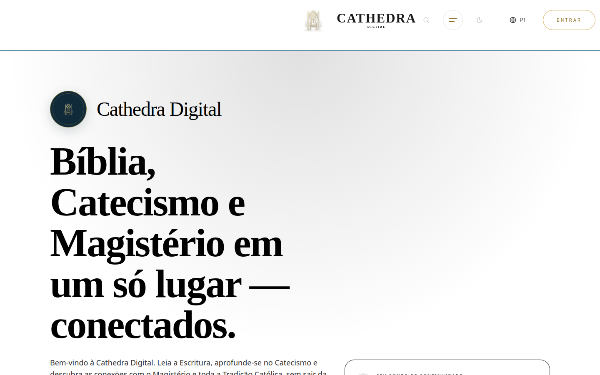
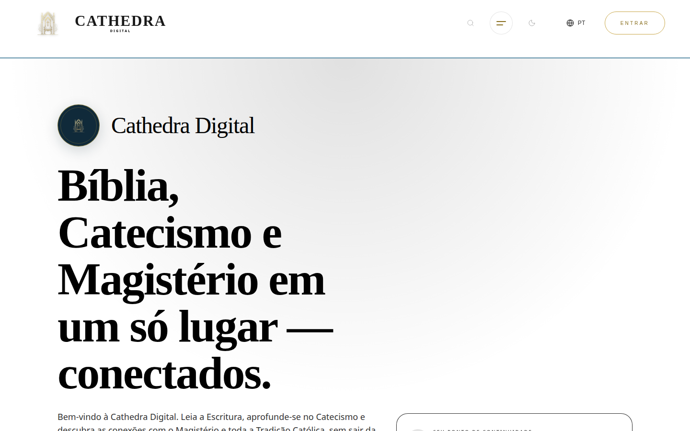

# Auditoria responsiva de UI/UX — Cathedra Digital

> **Atualização da revisão — 5 de novembro de 2026:** as seções abaixo preservam o histórico da inspeção de 3–4 de novembro. As afirmações de “sem push”, build pendente e divergência de projeto não representam o estado atual da PR #302. No SHA `2d354d3395d25112ffacf56810d8f9613a3d2d5a`, o [CI](https://github.com/cathedradigital/cathedradigital/actions/runs/42060128312) aprovou instalação, typecheck, lint e build; o [E2E público](https://github.com/cathedradigital/cathedradigital/actions/runs/42060128487) aprovou desktop e mobile. O job autenticado foi ignorado por ser uma PR, conforme a política de credenciais. A publicação exige os gates completos no SHA final da `main`. A revisão não altera URL, chave ou projeto Supabase nem comprova o ambiente publicado.

**Data:** 3–4 de novembro de 2026
**Base atual do patch:** `origin/main` / worktree `fix/responsive-ui-overflow-20261103`, SHA `4d32ef5311aa34199ad7507dde3aab6254d2611a`.
**Site público inspecionado:** https://cathedradigital.com.br/

## Resumo executivo

A varredura cobriu 12 rotas públicas em seis larguras (320, 360, 390, 768, 1024 e 1440 px), totalizando 72 combinações. Todas responderam HTTP 200; não ocorreram erros JavaScript de página nem `documentElement.scrollWidth` maior que o viewport. Isso, porém, não significou layout sem problemas: encontrei overflow interno e alinhamento incorreto em três componentes, reproduzidos por medições no DOM e conferidos visualmente.

Corrigi localmente o container do cabeçalho desktop, a distribuição/legibilidade dos rótulos do carousel móvel e o espaçamento da grade do rodapé, nesta worktree baseada na `origin/main` atual. Uma simulação de estilos no navegador público confirmou as medidas antes/depois sem modificar o site. **A produção não mudou:** não houve commit, push, build ou publicação.

## Escopo e método

Rotas examinadas: `/`, `/estudar`, `/bible?book=Gn&ch=1`, `/catechism?p=279`, `/magisterium/dce`, `/aparicoes`, `/santos`, `/oracao/rosario`, `/jornadas`, `/buscar?q=Esperança`, `/hoje` e `/logos`. A inspeção do site público foi somente leitura; não houve login, gravação em banco nem envio de formulários. O scanner mediu largura de página e overflow interno de elementos. As capturas visuais foram feitas após a animação transitória inicial desaparecer.

## Achados e correções

| Prioridade | Componente | Evidência antes | Causa | Correção local |
|---|---|---|---|---|
| **Alta** | Cabeçalho desktop | Em 1440 px, container de 96 px (`scrollWidth=757`); em 1024 px, container de 96 px (`scrollWidth=736`). Logo e controles ficavam deslocados à direita. | `src/components/cathedra/AppHeader.tsx:78` usava `max-w-spacing-4xl`, que mapeia para 6 rem/96 px — um token de espaçamento usado indevidamente como largura máxima. | Substituí por `max-w-[var(--layout-max-width)]`, preservando o padding lateral existente. Na simulação: 1400 px disponíveis em viewport 1440 e 1024 px em viewport 1024, sem overflow interno. |
| **Média** | Navegação móvel | Em 390 px, trilho de 405 px (`clientWidth=390`); “Minha Jornada” ficava cortado. Em 360 px também excedia a largura disponível. A barra de rolagem estava escondida. | `src/components/mobile/MobileModuleCarousel.tsx:120,133,147` combinava rolagem sem indicador, itens que não encolhem e `truncate whitespace-nowrap`. | Os seis itens agora podem dividir o espaço, mantêm largura mínima de toque de 48 px e deixam rótulos longos quebrarem em duas linhas; a rolagem permanece como fallback para telas muito estreitas. O `aria-label` completo continua disponível. Na simulação, o trilho mediu 320/320, 360/360 e 390/390 px após o ajuste. |
| **Média** | Rodapé desktop | Em 1024 px, a coluna da marca era 102 px contra 146 px de conteúdo; em 1440 px, 154 px contra 177 px. | `src/components/cathedra/Footer.tsx:266` usa cinco colunas; `lg:gap-spacing-4xl` equivale a 96 px e comprime as colunas intermediárias. | Reduzi a lacuna desktop para `lg:gap-spacing-xl` (32 px). Na simulação, a coluna passou de 102/146 para 154/154 px em 1024, e de 154/177 para 205/205 px em 1440 (largura da coluna/conteúdo). |

### Evidência visual: mobile

### Evidência visual: desktop

## Observações sobre design system e UX

- A folha global aplica `overflow-x: clip` a `html` e `body` (`src/styles.css:15-22`). Isso contém a rolagem horizontal da página, mas não corrige filhos que excedem a própria coluna e pode esconder o sintoma. Recomendo manter essa regra somente como contenção depois de corrigir as causas nos componentes.
- Há camadas de tokens em paralelo (core, SP4, Stitch e Tailwind legado), e famílias/tamanhos tipográficos também são definidos por tokens, CSS global e estilos inline. Recomendo consolidar gradualmente em torno dos tokens semânticos existentes, com regras explícitas de largura e tipografia; não é necessário fazer uma migração ampla junto com estas correções.
- O título principal da homepage quebra dentro do viewport móvel testado; não detectei overflow horizontal global nas larguras examinadas. A animação/overlay inicial aparece brevemente e desaparece após alguns segundos; foi mantida, pois não é um overflow persistente.

## Complemento — refinamento do módulo Formar e do login

Em 4 de novembro, a rota ativa `/jornadas` foi revisada em 320, 360, 390, 768, 1024 e 1440 px com dados de usuário/jornadas sintéticos e requests externos de escrita bloqueados. A página manteve `scrollWidth` igual à viewport e zero overflow interno detectado. A continuidade, jornada em destaque e catálogo foram distinguidos visualmente; adicionaram-se CTA visível de “Continuar”, filtros com estado `aria-pressed`, alvos de toque de 44 px vinculados ao token existente, progresso acessível e estados vazios mais claros. Foram removidos a duplicação de jornada entre destaque/recomendações e o atalho para a experiência legada.

Em 5 de novembro, o login ativo (`/auth`, também acessado pelo alias `/login`) recebeu cartão responsivo, campos de 48 px, foco visível, botão de mostrar/ocultar senha, estados de envio/erro acessíveis e mensagens de erro amigáveis em vez de texto técnico cru. A restrição HTML de senha mínima foi mantida para cadastro, mas não é imposta ao login de contas existentes. Um teste local em 320, 390 e 1440 px verificou ausência de overflow, alternância de senha, cadastro/recuperação e preservação de `next`; nenhuma credencial foi submetida e nenhuma escrita foi feita.

**Limitação de autenticação real:** o preview local foi isolado com respostas mockadas. A configuração fonte ainda aponta para o Project Ref Supabase `isojguvcnfncokoxoauk`, enquanto o Project Ref esperado informado por você é `gpwrpmoniglarqwfyryp`; a consulta DNS atual ao endpoint esperado retornou NXDOMAIN (status 3). Portanto, estes resultados validam a interface e os modos do formulário, não login contra o Supabase real, envio de email nem OAuth. Não substituí endpoint nem chave por valores presumidos.

## Validação

- Scanner público: 72 combinações rota/largura; 72 respostas HTTP 200, zero erros de página e zero casos de `documentElement.scrollWidth` maior que o viewport. Os excessos citados são internos a componentes.
- Simulação somente leitura de CSS no navegador público: confirmou as medidas antes/depois descritas nas três correções. Os screenshots “depois” são simulações temporárias e não demonstram um build ou deploy da branch.
- `git diff --check`: passou.
- `bun run typecheck`: passou (`tsc --noEmit`, código de saída 0).
- `bun run lint`: concluiu sem erros; a execução completa reportou 1132 avisos no repositório. A checagem dos arquivos alterados de UI (`AppHeader`, `MobileModuleCarousel`, `Footer`, `AtriumJornadasPage`, `Sidebar` e `Auth`) passou sem erros quando executada sem promover warnings antigos a erros; a execução estrita (`--max-warnings=0`) apontou dois `no-explicit-any` preexistentes em `AppHeader.tsx:19,161`.
- `check-deploy-assets.mjs`, `validate-module-contracts.mjs`, `validate-security-boundaries.mjs` e `validate-e2e-security.mjs`: todos passaram nesta base.
- `test:e2e:public` não chegou a executar casos: Playwright não conseguiu iniciar o preview local porque `dist/index.html` não existia. Não gerei o bundle porque a configuração Supabase que seria empacotada usa o Project Ref `isojguvcnfncokoxoauk`, diferente do `gpwrpmoniglarqwfyryp` confirmado por você; o endpoint e a chave publicável esperados ainda não foram validados. **Build e E2E da versão corrigida continuam pendentes.**

## Integração e publicação

O patch está na worktree `/home/ubuntu/catedradigital-ui-audit`, branch `fix/responsive-ui-overflow-20261103`, baseada no `origin/main` atual (`4d32ef5`). O checkout `/home/ubuntu/catedradigital`, branch local `main`, está **48 commits atrás** de `origin/main` e contém alterações locais anteriores de segurança/CI; mantive esse estado intacto e não o usei como base do patch. Não houve push nem deploy.

O deploy continua bloqueado pela divergência Supabase: o fallback no código aponta para projeto diferente do Project Ref `gpwrpmoniglarqwfyryp` informado por você, e ainda não foi possível validar endpoint e chave publicável do projeto esperado. Não alterei URL/chaves nem publiquei. Próximo passo seguro: validar/acertar configuração pública Supabase no repositório atual, integrar as correções responsivas preservando os fixes de segurança, e então executar build e E2E antes do push à `main`.
